### Now

- 🏥 **Medical Operations and Data @ Tandem** — deploying ambient clinical AI across NHS hospitals
- 🔬 **AI safety research** — chain-of-thought monitoring with Algoverse (upcoming...)
- ❓ [When to Ask: An RL Environment That Teaches AI Agents to Act on What Users Mean and Not Just What They Say](https://apartresearch.com/sprints/projects/when-to-ask-an-rl-environment-that-teaches-ai-agents-to-act-on-what-users-mean-and-not-just-what-they-say-1fuf) — 3rd place Apart Research's AI incident response sprint project
- 🗣️ [Is functional welfare speakable?](https://latentmindsinstitute.com/speakable-welfare/) — RL-trained welfare directions vs. the Jacobian-lens verbalizable subspace
- 🛡️ [LLM Guardrails with HUX AI](https://huxai.tech/researchinternshipreports/llm-guardrails-evaluation-toolkit/) — Where Llama Guard breaks under RAG
- ⚖️ [Medical Debate with BlueDot Impact](https://github.com/PS5138/llm_debate) — debate as a scalable oversight for medical diagnosis

